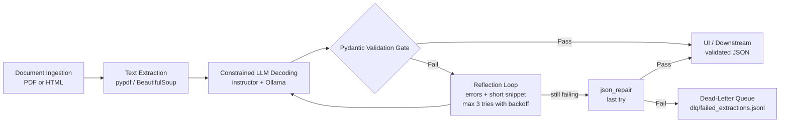

# Structured Data Extractor

This project reads messy invoices (PDF or HTML) and turns them into clean, validated JSON.
A local AI model (Ollama) reads the text. Pydantic v2 checks every field.
If the answer is wrong, the app sends the errors back to the model and asks it to fix them.
If it still fails, the document goes to a dead-letter queue (DLQ) so nothing is lost and nothing crashes.

No API keys are used. The model runs on your own computer.

## How it works



1. **Document Ingestion:** upload a PDF, paste HTML or text, or pick a bundled sample.
2. **Text Extraction:** `pypdf` reads PDFs and `BeautifulSoup` reads HTML. Extra spaces and scripts are removed.
3. **Constrained LLM Decoding:** `instructor` sends the JSON schema to the model and asks for JSON only.
4. **Pydantic Validation Gate:** the JSON must pass every rule in `src/schemas.py`. A small extra check also makes sure the invoice number and the total really appear in the document, because a small local model can invent an invoice from text that is not an invoice.
5. **Reflection Loop:** on failure, the model gets the exact errors (field and message), its previous JSON and a short part of the document. It does not get the whole document again.
6. **DLQ:** after the last try, `json_repair` gets one chance. If that fails, the input, the last output and all errors are saved as one line in `dlq/failed_extractions.jsonl` and the result is `DLQ_FAILED`.

## Project structure

```
structured-data-extractor/
├── src/
│   ├── schemas.py       # Pydantic v2 models and validators
│   ├── extractor.py     # text ingestion and the retry pipeline
│   ├── fallback.py      # reflection prompt, json_repair, DLQ writer
│   └── app.py           # Streamlit UI
├── tests/
│   ├── test_extraction.py
│   └── test_fallbacks.py
├── samples/
│   ├── invoice_messy.pdf
│   └── vendor_contract.html
├── Dockerfile
├── docker-compose.yml
├── ai_prompt_log.md
└── .env.example
```

## Setup (Mac)

### 1. Install uv and Python 3.11

```bash
brew install uv          # or: curl -LsSf https://astral.sh/uv/install.sh | sh
cd structured-data-extractor
uv python install 3.11
uv sync
```

The Python version is pinned in `.python-version`.

### 2. Install Ollama and download the model

Option A, with Homebrew:

```bash
brew install ollama
ollama serve             # keep this terminal open
```

Option B, with the app: download Ollama for Mac from https://ollama.com/download, move it to Applications and open it. It runs in the menu bar.

Then download the model (about 2 GB, one time only):

```bash
ollama pull llama3.2:3b
ollama list              # check that the model is there
```

### 3. Settings (optional)

```bash
cp .env.example .env
```

| Variable | Default | Meaning |
|---|---|---|
| `OLLAMA_MODEL` | `llama3.2:3b` | the local model to use |
| `OLLAMA_BASE_URL` | `http://localhost:11434/v1` | the Ollama OpenAI-compatible address |

No API key is needed. The code sends the placeholder `"ollama"` because the OpenAI library needs some value.

## Commands

Run the app (opens http://localhost:8501):

```bash
uv run streamlit run src/app.py
```

Run the tests (they use mock answers, so Ollama is not needed):

```bash
uv run pytest -v
```

Run with Docker (Ollama must be running on your Mac first):

```bash
docker compose up --build
```

## Using the app

- **Document source:** bundled sample, upload a PDF, or paste HTML or text.
- **Reflection loop toggle:** turn it off to see a single try with no self-correction.
- **Side by side:** raw text on the left, validated JSON on the right.
- **Reconciliation badge:** green MATCH when line items + tax = total, red MISMATCH if not.
- **Audit log:** each attempt with the raw model output, the exact validation errors and the corrective prompt that was sent.
- **Simulate Edge Case Failure:** uses a fake broken model answer to show the full DLQ path. It works even when Ollama is off.

If Ollama is not running, the app shows a clear message with the steps to start it.

## Deployment

This project uses a local model and no API keys, so it cannot run on a free cloud host like Streamlit Community Cloud (the cloud server cannot reach Ollama on my Mac).
The deployment option is **local Docker**. The container runs the Streamlit app and talks to Ollama on the host Mac through `http://host.docker.internal:11434/v1`.

```bash
ollama serve                 # on the Mac
docker compose up --build    # in the project folder
# open http://localhost:8501
```

Failed extractions from the container are saved to `./dlq` on the Mac.

## Schema specification

**LineItem**

| Field | Type | Rule |
|---|---|---|
| `description` | str | not empty |
| `quantity` | int | > 0 |
| `unit_price` | float | > 0, money text like `$349.75` is cleaned |
| `line_total` | float | money text is cleaned |

**InvoiceExtraction**

| Field | Type | Rule |
|---|---|---|
| `invoice_number` | str | regex `^[A-Za-z0-9][A-Za-z0-9\-/#]{2,29}$` |
| `vendor_name` | str | not empty |
| `invoice_date` | date | ISO-8601. A pre-parser also reads dates like `12th of Oct, 2024` |
| `line_items` | List[LineItem] | at least 1 item |
| `subtotal` | float | money text is cleaned |
| `tax_amount` | float | >= 0 |
| `total_amount` | float | > 0 |
| `currency` | Literal | `USD`, `EUR` or `GBP`. Symbols `$ € £` are mapped to codes |
| (model check) | | sum of `line_total` + `tax_amount` = `total_amount` (within 0.02) |

**ExtractionResult**

| Field | Type | Meaning |
|---|---|---|
| `validated_data` | Optional[InvoiceExtraction] | the clean data, or `None` on failure |
| `attempts_used` | int | how many model calls were made |
| `error_log` | List[str] | every error as `attempt N \| field: message` |
| `execution_status` | Literal | `SUCCESS`, `REPAIRED_VIA_REFLECTION` or `DLQ_FAILED` |
| `raw_responses` | List[str] | raw model output per attempt (for the audit log) |
| `corrective_prompts` | List[str] | the exact retry prompts (for the audit log) |

A result can never be "half empty". `SUCCESS` and `REPAIRED_VIA_REFLECTION` must have data, and `DLQ_FAILED` must have none.

## Tests

| Test | What it checks |
|---|---|
| `test_golden_extraction_succeeds_first_try` | the sample PDF text + a good mock answer gives `SUCCESS` on attempt 1 with no errors |
| `test_quantity_zero_or_negative_total_is_rejected` | quantity 0 and a negative total raise `ValidationError` |
| `test_line_item_sum_mismatch_fails` | wrong total fails the reconciliation check |
| `test_messy_values_are_cleaned` | `12th of Oct, 2024`, `$1,249.50` and `$` are cleaned |
| `test_bad_money_text_is_an_error_not_zero` | bad money text is an error, not a silent 0 |
| `test_html_sample_is_cleaned` | HTML tags and scripts are removed |
| `test_reflection_self_heals_on_attempt_2` | missing currency is fixed on attempt 2 |
| `test_bad_date_is_fixed_by_reflection` | a bad date is fixed on attempt 2 |
| `test_nonsense_goes_to_dlq_after_3_tries` | nonsense gives `DLQ_FAILED` after 3 tries and writes the DLQ file |
| `test_backoff_waits_longer_each_time` | waits 1s then 2s between tries |
| `test_json_repair_saves_broken_json` | broken JSON is saved by `json_repair` |
| `test_retry_prompt_does_not_resend_the_whole_document` | retry prompts stay short |
| `test_invented_invoice_is_not_accepted` | an invoice the model made up (values not in the text) goes to the DLQ |

## AI audit log summary

The first draft of `schemas.py`, `extractor.py` and `fallback.py` was generated by an AI coding assistant. I reviewed it and found these problems (full details with before and after code in `ai_prompt_log.md`):

1. **Pydantic v1 syntax:** it used `@validator` and `@root_validator`. The `@root_validator` crashed on import with Pydantic 2.
2. **Context stuffing:** every retry sent the whole document again.
3. **Swallowed errors and empty objects:** all fields were optional, a failure returned an empty `InvoiceExtraction()`, and `except Exception` hid the real error.
4. **Fragile date and type parsing:** only `YYYY-MM-DD` dates worked, line item prices were not cleaned, and currency symbols were rejected.

All four are fixed in the final code and covered by tests.

## Known limits

- `llama3.2:3b` is small. On my tests it read both samples correctly on the first try, but it takes about 15 to 30 seconds per document on a CPU.
- Dates like `03/04/2025` are read as US style (month first).
- The grounding check only looks for the invoice number and the total in the text. It does not check every field.
